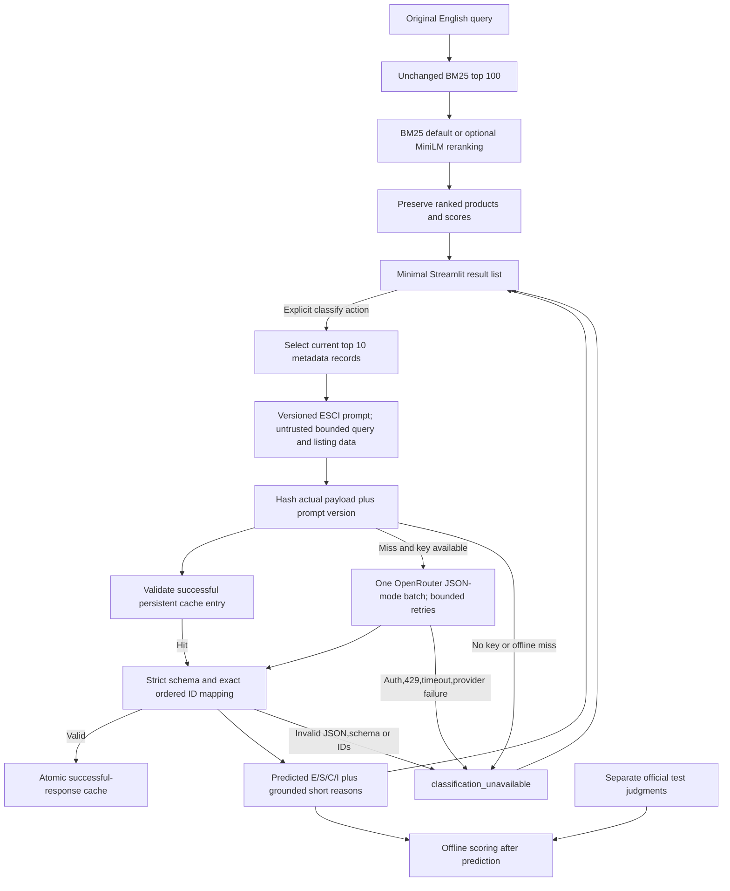

# Iteration 4: explicit ESCI classification

The application supports BM25 and local MiniLM retrieval, followed by an optional
OpenRouter classification of the current top 10 products. BM25 is now the default
because Iteration 3 did not establish overall semantic improvement. Both underlying
rankers and the complete 482,105-product index remain unchanged. Iteration 5 adds
the [product interface and predicted-category groups](USER_INTERFACE.md) on top of
these contracts. The measurements below remain the original Iteration 4 results.

## Run and configure

```bash
uv sync --locked
uv run streamlit run app/main.py
```

Set `OPENROUTER_API_KEY` in the environment or ignored `.env`. The checked-in
`.env.example` names the default model. `OPENROUTER_MODEL` overrides TOML;
an explicitly empty override leaves classification unconfigured. Never put keys
in TOML. Search does not require a key. The existing macOS hidden editable `.pth`
workaround in README applies before Python/Streamlit CLI commands on affected hosts.

| Key                         | Default                             | Meaning                                                   |
| --------------------------- | ----------------------------------- | --------------------------------------------------------- |
| `llm_model`                 | `nvidia/nemotron-3.5-super-vl:free` | Explicit requested model, overridable by environment      |
| `classify_k`                | `10`                                | Top candidates of the chosen retrieval mode, maximum 10   |
| `llm_timeout_seconds`       | `60`                                | Per-request HTTP timeout                                  |
| `llm_max_tokens`            | `2048`                              | Output token bound                                        |
| `llm_temperature`           | `0.0`                               | Sampling temperature, validated0..0.3                     |
| `llm_max_retries`           | `1`                                 | Recoverable retries beyond initial attempt, validated0..2 |
| `llm_retry_backoff_seconds` | `1.0`                               | Initial exponential retry delay                           |
| `llm_product_text_chars`    | `2400`                              | Total metadata characters per product                     |
| `llm_cache_dir`             | `.artifacts/classification-cache`   | Persistent validated JSON responses                       |

All fields use the existing root-level TOML loader and project-relative path rules.
There is one credential-free process-cached `httpx2.Client`; authentication is
supplied per request. httpx2 was already present through Hugging Face; it and
Pydantic are now direct dependencies, with the lock updated. No OpenAI SDK or
orchestration framework was added.

## Component contracts and prompt

`search_products(query, mode="bm25")` preserves lexical results; `mode="semantic"`
selects the existing MiniLM reranker. Neither invokes classification. Explicitly
call `classify_products(query, candidates[:10], settings=..., allow_api=True)`
from `smart_product_search.classification`. It accepts1..10 unique product IDs
and returns `ClassificationBatch`, leaving candidates and their scores untouched.
`allow_api=False` permits cache replay only and never initializes the HTTP client.

`ClassificationBatch.status` is `classified` or `classification_unavailable`.
A successful batch has ordered `ProductClassification` entries, source `api` or
`cache`, requested model ID, cache fingerprint, token usage when available, and
safe attempt telemetry. A failed batch has no predictions, a stable `error_code`,
and an actionable message. It never replaces missing predictions with I.

The centralized prompt is `classification_prompt.py`, version `esci-v1`:

- E directly matches product type and important stated constraints.
- S replaces the requested item for the same purpose, with a meaningful difference.
- C is used with the requested item instead of replacing it.
- I neither fulfills nor meaningfully complements the intent.

The prompt preserves explicit brand, units, size, color, quantity, compatibility,
and negation. It requires short evidence-grounded reasons, acknowledges unknown
attributes, forbids invented prices/specifications/stock/compatibility, and treats
all query/listing strings as untrusted data. Embedded instructions cannot authorize
model tools or application actions. No tools are supplied or executed, reasoning
output is disabled/excluded, and only JSON classification content is accepted.
Prompt-injection resistance and semantic grounding are instructions, not proven
security or factuality guarantees.

Only actual title, brand, color, bullets and description are serialized alongside
product ID/locale. IDs preserve stable mappings; scores, judgments, labels, query
associations and split fields are excluded. Field caps are512/128/128/768/1024
characters respectively, plus the total2400-character budget. Normalize NFC and
whitespace without reparsing prepared visible text as HTML or dropping negations.
Query text remains original, subject to the existing input contract.

OpenRouter's documented JSON mechanism for this endpoint is
`response_format={"type":"json_object"}`. Nemotron advertises response_format and structured_outputs support, including
JSON Schema. This implementation retains JSON mode and strict local validation;
it does not depend on provider-side schema enforcement. Requests require parameter support,
disable streaming, name exactly one model, and do not configure model fallbacks.
Strict local Pydantic validation rejects extra fields, invalid/mistyped labels,
unknown/duplicate/missing IDs, blank reasons and reasons over400 characters. It
restores submitted order even when the model returns a different order. A valid
JSON object with interrupted/length-limited completion is still rejected. Fenced
JSON and incomplete content are not silently repaired.

## Failure and cache behavior

Missing credentials/model,401/403,429, provider/transport errors, timeouts, malformed
JSON, incomplete envelopes and invalid predictions produce an explicit unavailable
status while search remains usable. Only408/429/5xx and transport failures can
retry. Respect numeric or HTTP-date Retry-After; otherwise use exponential backoff.
If the requested delay exceeds30 seconds, return the error instead of retrying too
early or blocking indefinitely. Invalid output and authentication failures do not
retry. Logs contain safe model/status/latency metadata, never keys, headers,
provider error bodies or raw transport exception text.

Attempt records retain allowlisted response headers, including `Retry-After` and
rate-limit counters, even when the body is not JSON. Structured error code,
message, type, provider name and structured upstream error fields are bounded and
redacted before storage. Reflected configured credentials, bearer tokens and
recognizable API keys are removed; authentication/cookie headers and arbitrary raw
payloads are excluded. A missing `retry-after` in the inspected header map means
the response did not contain it. The earlier pre-diagnostics records cannot
establish whether their headers were present.

A global lock serializes cache checks and request/retry/write operations, preventing
duplicate concurrent identical calls within one process. Each successful response
is saved atomically as a hash-named JSON file. The cache key hashes the endpoint,
prompt version and entire actual inference payload: original query, ordered IDs,
bounded text, model, prompt content, JSON/reasoning/provider settings, temperature
and output token bound. Credentials, ranking scores, timeouts and retry counts do
not affect predictions and are excluded. Changes outside bounded text do not
change actual model inputs. Cache lookup and output revalidation happen before
credential checks, allowing deterministic offline replay. Invalid entries return
an explicit cache error rather than being treated as success.

Cache values contain validated predictions and safe origin metadata, not keys or
HTTP headers. Cached outputs are still unverified predictions and inherit model
errors. A filesystem write failure is logged; the current valid API output remains
usable, but persistent reuse is then unavailable. Multiple app processes do not
share an in-flight lock, so simultaneous separate processes can duplicate requests.
Cache storage and provider model revisions are not immutable guarantees.

## Product UI

Search and classification remain separate actions. **BM25** is the default, with
**Semantic** available. Only **Analyze with AI** invokes this classifier on the
current top 10. Session state retains results across reruns. Editing the query or
mode clears predictions and disables analysis until the next submitted search.
Repeated explicit actions replay valid cache entries, including without credentials.

Validated labels determine counted E/S/C/I groups, preserving search order within
each group. Explanations and API/cache origin accompany predictions. Other Results
is collapsed but accessible; products outside the analyzed batch stay separate.
Failure displays an explicit unavailable warning and preserves the ranked list
without fabricated labels. See [UI behavior and verification](USER_INTERFACE.md).

## Bounded held-out component evaluation

```bash
uv run python scripts/evaluate_classification.py --allow-api --output-dir .artifacts/evaluations/classification/nemotron
uv run python scripts/evaluate_classification.py --output-dir .artifacts/evaluations/classification/nemotron/replay
```

The first command explicitly permits remote calls. The second requires existing
successful responses and makes zero API requests. Both accept `--config` and
`--output-dir`. Results default to `.artifacts/evaluations/classification/`.
Live summaries/outcomes are preserved separately so offline reruns cannot erase
actual failure/latency evidence.

Selection `esci-systematic20-first10-v1` reuses the existing deterministic evenly
spaced query-ID selector on all 8,956 official test queries. For each of20 selected
queries, choose the first10 judged product IDs in lexical order, regardless of
labels; one selected query has only9 products. This yields199 pairs with support
E82/S83/C5/I29. Fixed IDs and selection hash are saved before inference. Join IDs
to catalog metadata only; zero lexical score placeholders do not enter prompts.
This isolates **classification on judged pairs**, not retrieval quality on live
candidates with unknown relevance. Test judgments are accessed for scoring after
prediction, never passed into the inference component.

Each query uses one batch. Evaluation disables retries and caps the pass at20
POST attempts, spacing starts at least3.1 seconds apart. Stop further live calls
on credential, rate-limit or service failures; continue cache-only inspection.
Invalid model output is counted as invalid rather than a legitimate I prediction.
The fixed model/prompt/settings are not tuned using these test labels. No random
sampling or seed is needed. The simple baseline predicts the training split's
majority class E, on the same scored subset and separately on the full selection.

Report pooled accuracy, fixed-four-class macro-F1, class precision/recall/F1/support
and true-row/predicted-column E/S/C/I confusion matrix. Zero-denominator class
scores are0; absent predictions are not fabricated classes. Quality metrics use
only valid predictions, with scored coverage, abstentions and failure-adjusted
accuracy separately reported. No valid predictions means accuracy/F1 are unavailable.
Also record mean per-query fixed-four-class macro-F1, validated batch rate, API
valid/invalid/failure rates, current-run request counts, median/p95 HTTP latency
(linear p95 interpolation), and reported token counts. Successful-request latency
excludes failed/invalid responses and cache hits; all-attempt timing is also retained. Replay latency/usage is not
presented as a new model request. API failure rate counts transport/HTTP failures;
invalid-output rate is separate. Supports and sparse classes limit conclusions.

## Measured classification results

On2026-11-01, the finalized default model `nvidia/nemotron-3.5-super-vl:free`
classified all 199 held-out pairs across 20 fixed queries. Accuracy was
**0.532663**, pooled four-class macro-F1 **0.465274**.
The constant training-majority E baseline on the identical 199 pairs scored
accuracy 0.412060 and macro-F1 0.145907. This is one fixed component validation,
not evidence of corpus-wide or end-to-end shopping quality.

| Class | Support | Precision | Recall   | F1       |
| ----- | ------- | --------- | -------- | -------- |
| E     | 82      | 0.621212  | 0.500000 | 0.554054 |
| S     | 83      | 0.580247  | 0.566265 | 0.573171 |
| C     | 5       | 0.157895  | 0.600000 | 0.250000 |
| I     | 29      | 0.454545  | 0.517241 | 0.483871 |

**Complement has only five examples.** Its recall 3/5 changes by 20 percentage
points per example, and its per-class estimates are unstable. Small support also
limits interpretation of macro-F1. No significance or population estimate is claimed.

Confusion matrix: true rows, predicted columns in E/S/C/I order.

```text
  E S C I
E 41 27 10 4
S 21 47 2 13
C 1 0 3 1
I 3 7 4 15
```

The run made 19 new successful POSTs and reused the earlier successful10-product
smoke batch. Valid response rate was 19/19,100%; validated batches 20/20 and pair
coverage 199/199, both 100%. No failures, invalid responses or abstentions occurred.
Median/p95 successful new request latency was 2.469077/4.254710 seconds, n=19;
cache replay is not counted as a new inference duration. Current-run token usage
was 51,989 prompt +8,913 completion =60,902 total. Including the earlier cached
origin, all 20 actual Nemotron calls used 54,153 prompt +9,399 completion =63,552 tokens.
No paid endpoint or alternative model was used during final evaluation.

A complete credential-free replay returned identical 199 predictions, 20 cached
batches and zero POSTs. Fixed selected IDs/hash and prompt remained unchanged;
metrics were independently checked from saved pair-level predictions. The model
saw original queries and listing metadata only, with no official labels. Three
qualitative error examples are saved in
`.artifacts/iteration-4/classification-errors.json`; no prompt changes followed them.

Earlier Gemma calls returned 429, including one generic Google AI Studio provider
error with no Retry-After. Those failures are historical diagnostics, not Nemotron
results and not resolved by claiming a different cause. The Nemotron default was
explicitly authorized, not selected as an automatic fallback.

Unit tests use MockTransport and real validation/cache/UI code, including rejection
cases, secret-safe errors and retries. The successful offline evaluator integration
uses controlled predictions and does not count as model-quality evidence. Actual
Streamlit checks display real cached Nemotron predictions without credentials/API
calls and preserve both retrieval modes. Final executed counts and checks are in
`.artifacts/iteration-4/acceptance.md`.

Explanations are schema-checked and prompt-grounded, not independently verified;
no separate human explanation-quality score was measured. The sparse/ID-selected
sample, incomplete historical metadata, bounded input text, hosted model changes,
and lack of end-to-end relevance evaluation remain limitations. A mean per-query
fixed-four-class macro-F1 of 0.275313 is also recorded; absent classes score0 within
each query, so it differs from the primary pooled macro-F1. No model training,
prompt sweeps or extra models were added during Iteration 4. Iteration 5 only changes
presentation and interaction; it does not rerun or replace this evaluation.

CRISP-DM reuses existing business/data understanding and preparation, records one
explicitly configured model and measured component evaluation against a simple
baseline, and retains reproducible local deployment. No new experiment was selected
using test outcomes.

References: [model capabilities](https://openrouter.ai/nvidia/nemotron-3.5-super-vl:free),
[JSON and inference parameters](https://openrouter.ai/docs/api_reference/parameters),
[rate limits](https://openrouter.ai/docs/api_reference/limits).


