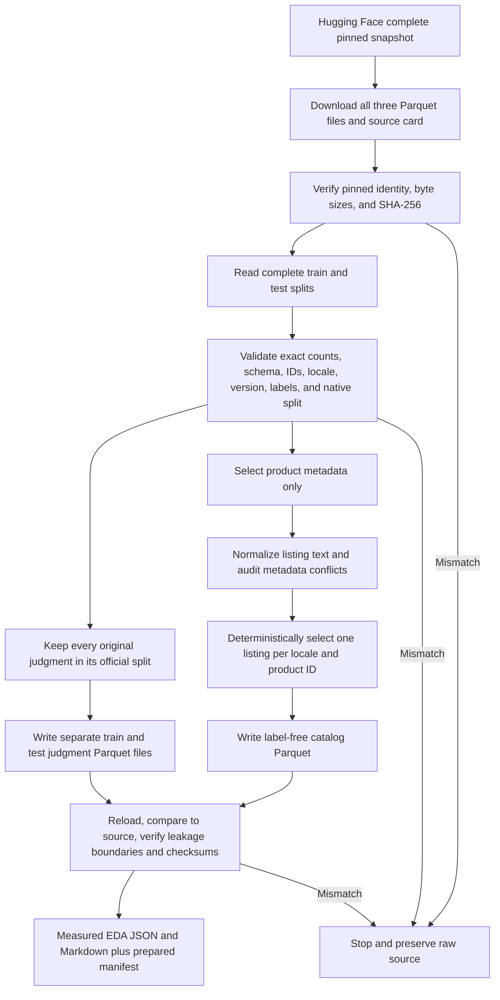

# Iteration 1: complete ESCI data preparation

This stage prepares a historical reference catalog and separate benchmark
judgments for Smart Product Search. It does not create a search index, fit or load
models, classify products, or implement a UI. See [DATA_SETUP.md](DATA_SETUP.md) for
the original dataset contract and [IMPLEMENTATION_PLAN.md](IMPLEMENTATION_PLAN.md)
for the iteration boundaries.

## Reproduce the preparation

From the repository root with managed Python 3.14:

```bash
uv sync --locked
uv run python scripts/download_data.py
uv run python scripts/prepare_data.py
uv run python scripts/validate_data.py
```

All scripts accept `--config` and `--data-dir`. The data root defaults to `data_dir`
in `config/search.toml`. Preparation and validation also accept `--audit-dir`,
default `.artifacts/dataset-audit/`. These are local CPU operations. Initial download
requires internet; verified cached data can be prepared and validated offline.

The pinned source is
[`thebajajra/amazon-esci-english-small`](https://huggingface.co/datasets/thebajajra/amazon-esci-english-small/tree/e7bb589a050171ed4b97891bd517507f702af0c2),
revision `e7bb589a050171ed4b97891bd517507f702af0c2`.
The downloader requests all three specified Parquet files and the source README.
The Parquet transfer size is 398,348,357 bytes. File sizes and LFS SHA-256 values
were verified against Hugging Face metadata at that revision and are enforced in
`source.py`. No source substitution or first-N sampling is supported.

## Data flow and contracts



The Hugging Face snapshot is the only network operation. Every following component
is deterministic Python or Polars code. There are no model calls or agent loops.

| Component             | Input                                     | Output                              | Verification                                                                                          |
| --------------------- | ----------------------------------------- | ----------------------------------- | ----------------------------------------------------------------------------------------------------- |
| Source download       | Fixed repository, revision, and file list | Immutable raw snapshot and manifest | Exact bytes and SHA-256, pinned identity, cached rerun                                                |
| Source integrity      | Full native split                         | Validated original rows             | Counts, published types/columns, nonnull IDs/query, `us`, `small_version=1`, E/S/C/I, split agreement |
| Text normalization    | Optional listing field                    | Optional plain NFC text             | Fixed reference cases and identity baseline; numeric/negation preservation                            |
| Catalog selection     | Product fields across both splits         | One listing per composite identity  | Label/query mutation independence, reversed-order invariance, tie fixtures                            |
| Judgment preservation | Every labeled source pair                 | Original columns in separate splits | Exact frame comparison after sorting by example ID                                                    |
| Artifact validation   | Raw and prepared files                    | Passed checks and measured audit    | Checksums, implementation fingerprint, schema whitelist, rebuilt catalog comparison                   |

### Files and schemas

- `data/raw/<revision>/data/*.parquet`: original bytes, untouched after download.
- `data/raw/<revision>/README.md`: original source card, preserved unchanged.
- `data/raw/manifest.json`: source URLs/revision, download UTC time, license
  attribution, code commit, and filenames/sizes/checksums. Repeated verified download
  retains the original manifest and makes no network requests.
- `data/processed/catalog.parquet`: `product_locale`, `product_id`,
  `product_title`, `product_brand`, `product_color`, `product_bullet_point`,
  `product_description`, `product_title_original`, `has_title`, `index_text`.
- `data/processed/judgments_train.parquet` and `judgments_test.parquet`:
  `example_id`, `query_id`, original `query`, `product_locale`, `product_id`,
  `esci_label`, and original `split`.
- `data/processed/manifest.json`: source-manifest checksum, preparation code
  fingerprint, Polars version, output counts, byte sizes, and SHA-256 values.
- `.artifacts/dataset-audit/audit.json` and `audit.md`: measured EDA and checks.
- `.artifacts/iteration-1/acceptance.md`: executed checks, observed results,
  repeatability evidence, and remaining limitations.

The catalog primary key is `(product_locale, product_id)`. All source locales must
be `us`, so product IDs are also unique in this catalog. Query text is not normalized
or rewritten in the judgment files. The serialization-only `__index_level_0__`
column remains in raw files and is excluded from prepared data.

### Normalization and deterministic selection

Normalize all five listing fields with NFC Unicode and collapsed whitespace.
Decode HTML entities once while parsing, preserve inline text, separate structural blocks, remove
HTML tags/attributes/comments, and discard script/style bodies. Preserve case,
negations, model numbers, dimensions, units, fractions, and other meaningful
punctuation. Null or whitespace-only fields become null. Keep the original chosen
title separately; original full records remain available in the pinned source.
Escaped visible text such as `&lt;USB-C&gt;` becomes the literal token `<USB-C>`;
it must not be parsed again as markup. Similarly, encoded script-like text remains
visible untrusted data, while actual script elements and their bodies are removed.
Pipeline reruns always read original raw text, rather than re-cleaning prepared text.

Count distinct nonblank raw values per product field before selecting a catalog
record. A metadata conflict means more than one such value; it can include harmless
formatting variation. Selection prefers a nonempty normalized title, then the most
nonempty normalized listing fields, then lexical order of normalized fields and
original title. Keep one whole record. Do not merge contradictory attributes, use
labels/queries to pick a record, or depend on source row order.

Retain products with missing titles and mark `has_title=false`. Do not invent a
title or discard their benchmark judgments. `index_text` concatenates normalized
title, brand, color, bullets, and description, omitting nulls. It is prepared text,
not a search index. Full text is retained; model-specific bounded representations
and truncation are deferred to their actual implementation stages.

### Leakage and repeatability

The catalog is a transductive listing-only reference built from products in both
official splits. This permits known listing metadata but excludes gold labels,
query IDs/text, example IDs, splits, and query-product associations from serving
features. Official query splits remain unchanged; shared products are legitimate
reference data and are measured separately from query overlap.

The normalizer and tie-breaking policy use no randomness. Output rows and columns
have fixed order; Parquet uses Zstandard with fixed 128,000-row groups. Each file is
written to a temporary path and atomically replaced, with the prepared manifest
published after all data files. A failed multi-file run is not a transaction, but
checksum validation rejects a stale or partial artifact set. Repeating preparation
rebuilds the files; it does not append data. Source/code fingerprints prevent
silently validating stale preparation. No timestamps are added to deterministic
prepared outputs or EDA records; run timing belongs in execution logs.

## Observed statistics

Measured on the full pinned snapshot using Python 3.14.8, Polars 2.1.0, and
huggingface-hub 2.4.0. These are actual counts, not estimates or sampled statistics.

| Split | Judgments | Distinct query IDs | Distinct products |       E |       S |      C |      I |
| ----- | --------: | -----------------: | ----------------: | ------: | ------: | -----: | -----: |
| Train |   419,653 |             20,888 |           351,961 | 181,819 | 147,628 | 19,090 | 71,116 |
| Test  |   181,701 |              8,956 |           164,900 |  79,708 |  63,563 |  8,099 | 30,331 |

Combined: **601,354 judgments, 29,844 queries, and 482,105 unique products**.
Query ID overlap and exact query-text overlap are both zero. Products shared by
both splits: 34,756. Duplicate query-product groups: zero. Products with conflicting
nonblank raw metadata fields: zero. No judgment rows were removed.

| Field       | Missing/blank source rows | Missing/blank normalized products |
| ----------- | ------------------------: | --------------------------------: |
| Title       |                         0 |                                 0 |
| Brand       |                    29,650 |                            27,191 |
| Color       |                   184,947 |                           155,144 |
| Bullets     |                    70,128 |                            63,627 |
| Description |                   300,245 |                           230,384 |

The source description is absent in 49.9% of judgment rows. These gaps remain
missing; preparation does not invent product attributes. Exact null/blank counts,
per-split missingness, actual schemas, and provenance are in the audit JSON.
Validation and repeatability results are recorded in the acceptance report.

## Limitations and CRISP-DM status

Business understanding follows the selected product-search scope. Data
understanding and preparation use the complete pinned dataset with measured EDA.
Evaluation at this gate concerns integrity, deterministic transformation, and
label separation. Deployment at this gate is the reproducible local data CLI.
Modeling, retrieval quality, semantic/classifier evaluation, and a runnable search
application remain deferred to their authorized iterations.

These are historical, noisy listings with optional metadata and incomplete
catalog-wide relevance judgments. Locale `us` is verified, but no automatic
language identification or exhaustive privacy/PII audit has been performed. Text
is untrusted data; normalization does not make it trusted instructions or safe HTML.
Future rendering must escape original and normalized text. No live prices,
availability, ratings, or product images are inferred.

The original dataset is the Amazon Science Shopping Queries Dataset, released
under [Apache 2.0](https://github.com/amazon-science/esci-data/blob/main/LICENSE).
Preserve attribution to [Amazon Science and its original repository](https://github.com/amazon-science/esci-data).
The inspected pinned repack card contains schema/count metadata but no explicit
license field, contrary to the initial specification's claim. The original source
license and attribution URLs are recorded; this is not independent certification
of all repacked listing rights. No data or generated binaries are added to Git.
