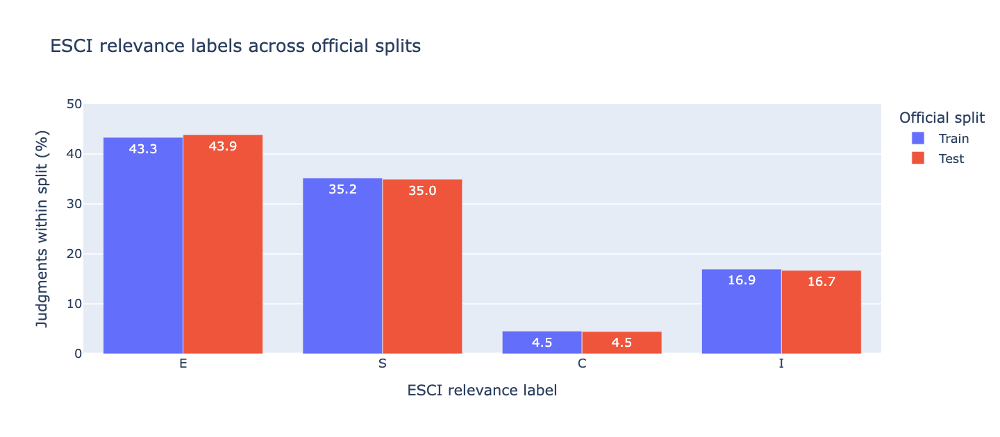
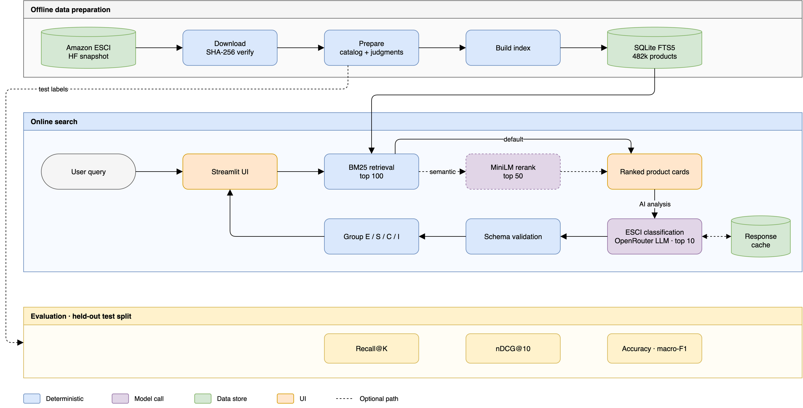

# Smart Product Search

Author: Nikita Lenyk

## 1. Problem and CRISP-DM approach

The idea of the project was based on the [Amazon ESCI English Small dataset](https://huggingface.co/datasets/thebajajra/amazon-esci-english-small/tree/e7bb589a050171ed4b97891bd517507f702af0c2).

Which provides a set of English user queries and their corresponding product listings on Amazon. It also include s relevance labels for each query-product pair, indicating whether the product is an exact match, a substitute, a complement, or irrelevant to the query.

The bussines model of the Smart Product Search is to help customers to find the most relevant or alternatives, and accessories for their queries.
An English query produces ranked cards
and, after explicit AI analysis, predicted relevance categories and explanations.
The pipeline combines retrieval, semantic similarity, and classification.
Purchases, live prices, inventory, and personalization are outside its scope

The project follows all six CRISP-DM phases:

| Phase                  | Application in this project                                                                                                                                                                   |
| ---------------------- | --------------------------------------------------------------------------------------------------------------------------------------------------------------------------------------------- |
| Business Understanding | Defined shoppers, English queries, useful grouped results, laptop execution, and explicit failure behavior in [PROJECT_IDEA.md](PROJECT_IDEA.md).                                             |
| Data Understanding     | Inspected the complete existing ESCI subset, provenance, class distributions, duplicates, missing metadata, and split overlap.                                                                |
| Data Preparation       | Normalized listings, created a unique product catalog, preserved official judgments, and verified deterministic outputs and label separation.                                                 |
| Modeling               | Started with BM25, added pretrained MiniLM reranking and a versioned LLM classification prompt without training models.                                                                       |
| Evaluation             | Compared BM25 and Semantic on fixed queries, scored classification against held-out labels and a majority baseline, and tested UI behavior. Mixed semantic results informed the BM25 default. |
| Deployment             | Delivered a locally runnable Streamlit application with configuration, caches, setup commands, and graceful API failure handling.                                                             |

A five-query assisted assessment and metadata review were completed, followed by
author review and acceptance of all 50 ratings. The method and limitations are below.

## 2. Dataset and preparation

The source is:
[`thebajajra/amazon-esci-english-small`](https://huggingface.co/datasets/thebajajra/amazon-esci-english-small/tree/e7bb589a050171ed4b97891bd517507f702af0c2),

All three Parquet downloads are verified by size and SHA-256.

| Official split | Query-product judgments | Distinct queries |
| -------------- | ----------------------: | ---------------: |
| Train          |                 419,653 |           20,888 |
| Test           |                 181,701 |            8,956 |

The catalog contains **482,105 unique products**, without duplicate query-product
pairs or overlapping query IDs or exact query texts between splits. The 34,756
shared products contribute listing metadata only. Query associations and gold
labels remain in separate judgment files. This is a transductive catalog setting.

Python and Polars remove HTML markup and script/style bodies, normalize Unicode
and whitespace, and preserve specifications and negation. Missing fields stay null.
All titles are present, but 230,384 products, or 47.79%, lack descriptions.
Deduplication uses locale and product ID without labels. Repeated preparation
produced byte-identical outputs.
See [data preparation](DATA_PREPARATION.md) for schemas, audit results, and attribution.

### Exploratory data analysis

Percentages below use query-product judgments within each split.

| Relevance label |     Train pairs |     Test pairs |
| --------------- | --------------: | -------------: |
| E, Exact        | 181,819 (43.3%) | 79,708 (43.9%) |
| S, Substitute   | 147,628 (35.2%) | 63,563 (35.0%) |
| C, Complement   |   19,090 (4.5%) |   8,099 (4.5%) |
| I, Irrelevant   |  71,116 (16.9%) | 30,331 (16.7%) |

Exact and Substitute dominate, while Complement accounts for only about 4.5%.
This imbalance motivates reporting macro-F1 alongside accuracy.

Metadata missingness uses the 482,105 unique catalog products as its denominator.

| Listing field | Products missing the field |  Share |
| ------------- | -------------------------: | -----: |
| Title         |                          0 |  0.00% |
| Brand         |                     27,191 |  5.64% |
| Bullet points |                     63,627 | 13.20% |
| Color         |                    155,144 | 32.18% |
| Description   |                    230,384 | 47.79% |

Complete titles support title-led retrieval. Sparse descriptions make other
attributes useful, but unavailable specifications must remain unknown.



The [EDA notebook](../notebooks/esci_eda.ipynb) recomputes these statistics from the
complete prepared files. It also plots missing metadata and judged products per
query, with findings and reproduction instructions. Both splits have a median of
16 judged products per query and a p95 of 40.

## 3. Components and application flow



Figure 1. Preparation, search, and isolated evaluation. Recall@K denotes coverage of
known positive judgments, not exhaustive catalog relevance.
[Editable diagram](architecture.drawio).

| Component                 | Purpose, input, and output                                                                                                                                                                             |
| ------------------------- | ------------------------------------------------------------------------------------------------------------------------------------------------------------------------------------------------------ |
| Download and preparation  | Pinned files become a normalized catalog and separate official judgments. Integrity and schema failures stop preparation.                                                                              |
| Index construction        | The catalog becomes SQLite product and FTS5 tables. Unique identities, deterministic insertion, integrity checks, and atomic replacement protect the index.                                            |
| BM25 retrieval            | Literal query tokens and parameterized SQL produce up to 100 ranked products. Title/brand/color/bullets/description weights are 5/3/1/2/1. Lower scores rank first, with stable identity tie-breaking. |
| Semantic reranking        | Optional `sentence-transformers/all-MiniLM-L6-v2` encodes the query and candidates on CPU. Cosine similarity selects the top 50. Ties preserve BM25 rank then identity.                                |
| LLM classification        | **Analyze with AI** sends the query and top 10 products in one OpenRouter Chat Completions request. `nvidia/nemotron-3.5-super-vl:free` predicts E/S/C/I and reasons from metadata.                    |
| Validation and caching    | Pydantic enforces valid labels, bounded nonempty reasons, and exactly one prediction per submitted ID. Successful outputs are persistently cached and revalidated on replay.                           |
| Grouping and Streamlit UI | Code groups validated predictions into Exact Matches, Alternatives, Accessories & Complements, and Other Results, preserving retrieval order. Unanalyzed products stay unclassified.                   |

MiniLM uses normalized 384-dimensional vectors, batches of 32, a 256-wordpiece
limit, and 1,200 product-text characters. Its pinned model is loaded once per
process configuration. A 10,000-entry cache reuses product embeddings. BM25 and
cosine scores remain separate.

The `esci-v1` prompt defines E as an exact match, S as a replacement, C as an
accessory used with the item, and I as irrelevant. It treats listing text as
untrusted data. JSON mode uses temperature 0, 2,048 output tokens, and a 60-second
timeout. Gold labels never enter inference. Cache identity includes query,
ordered products/text, model, prompt version, and inference settings.

For `waterproof backpack`, Search runs BM25 and optionally MiniLM, then displays
catalog candidates. **Analyze with AI** checks the top-10 batch cache before
requesting predictions. Success displays groups and reasons. Failure preserves
ranked cards with a warning. This illustrates control flow, not a measured prediction.

Session state retains results across reruns. Query or mode changes clear stale
analysis. Pagination and reruns make no API calls. Bounded recoverable retries
respect Retry-After. Failures never become fabricated I predictions.

## 4. Evaluation and findings

### Retrieval and semantic reranking

Both modes used the same 200 fixed official test queries over the full catalog.
Coverage averages each query's recovered fraction of known positives. Eligible
query counts are 200 for E and 172 for S. Unjudged relevance is unknown.

| Metric                          |      BM25 | BM25 + MiniLM |
| ------------------------------- | --------: | ------------: |
| Exact coverage@10               |    34.78% |        32.89% |
| Substitute coverage@10          |    13.77% |        14.80% |
| Exact coverage@50               |    55.52% |        54.97% |
| Exact-or-Substitute coverage@50 |    45.00% |        45.37% |
| Conditional judged-pool nDCG@10 |    0.8845 |        0.8995 |
| Median query latency            | 169.66 ms |   1,150.29 ms |
| p95 query latency               | 558.16 ms |   1,740.00 ms |

nDCG uses gains E=3, S=2, C=1, I=0 and a `log2(rank + 1)` discount. It projects
both orders onto the same judged subset of each top-100 pool, skipping unjudged
products. Excluding 11 zero-ideal pools leaves 189 queries. This conditional metric
does not describe actual display positions. Incomplete ESCI annotations also mean
coverage is not exhaustive corpus-wide recall.

MiniLM slightly improved conditional nDCG but reduced Exact coverage and increased
latency. Inspected errors included full-zip hoodies for a quarter-zip query and
weakened brand constraints. Overall improvement is unproven, so BM25 remains
default. Local latency excludes model initialization and UI rendering.
See [semantic evaluation](SEMANTIC_RERANKING.md#measured-component-results).

### ESCI classification

The subset contains 20 systematically selected official test queries and 199
judged pairs, taking up to 10 product IDs per query in lexical order. Selection
ignores labels, which are consulted after inference for scoring. This tests
classification of known pairs independently of live retrieval.

| Metric                     | Nemotron | Always-E training-majority baseline |
| -------------------------- | -------: | ----------------------------------: |
| Accuracy                   |   53.27% |                              41.21% |
| Pooled four-class macro-F1 |   0.4653 |                              0.1459 |

| Class | Support | Precision | Recall |     F1 |
| ----- | ------: | --------: | -----: | -----: |
| E     |      82 |    0.6212 | 0.5000 | 0.5541 |
| S     |      83 |    0.5802 | 0.5663 | 0.5732 |
| C     |       5 |    0.1579 | 0.6000 | 0.2500 |
| I     |      29 |    0.4545 | 0.5172 | 0.4839 |

The confusion matrix has true rows and predicted columns in E/S/C/I order.

```text
     E   S   C   I
E   41  27  10   4
S   21  47   2  13
C    1   0   3   1
I    3   7   4  15
```

All 199 predictions were valid. The pass made 19 successful requests and reused
one batch, with 100% coverage and zero API failures. Successful-request median/p95
latency was 2.469/4.255 seconds. All 20 originating calls reported 63,552 tokens.
Offline replay reproduced predictions without API calls. Validity is not accuracy.
Complement has only five examples, making its metrics unstable. Ten E products
were predicted C, illustrating accessory confusion.
See [classification results](CLASSIFICATION.md#measured-classification-results).

### Five-query workflow assessment

I collected the top 10 products before and after AI analysis for five BM25 queries.
Reference labels were recorded before viewing each classification response.
The reference labels and explanation ratings were proposed with LLM assistance.
A follow-up LLM-assisted metadata review on 2026-11-15 checked all 50 products
against the prepared catalog without changing labels or scores. I then reviewed
and accepted all 50 ratings on the same date. Both follow-up reviews had access
to the model predictions.
I reduced the original plan from 10 queries to
its first five after inspecting four cases, without replacing query texts.

| Query                                     | Category agreement | Supported explanations | E/S task success | Source |
| ----------------------------------------- | -----------------: | ---------------------: | ---------------- | ------ |
| Q01, wireless noise cancelling headphones |                4/8 |                   4/10 | Yes              | API    |
| Q02, waterproof hiking backpack 35 liter  |                3/3 |                   9/10 | Yes              | Cache  |
| Q03, case for Sony WH-1000XM4 headphones  |               7/10 |                  10/10 | No               | API    |
| Q04, white cotton t shirt                 |               9/10 |                   9/10 | Yes              | API    |
| Q05, stainless steel water bottle 1 liter |              10/10 |                  10/10 | Yes              | API    |

Pooled category agreement was **33/41, 80.49%**, excluding nine uncertain references.
Explanation support was **42/50, 84%**, assessed against listing text and query
requirements. Useful-candidate coverage and defined E/S task success were both
**4/5, 80%**. Success requires one reference E/S product in a predicted E/S group
with a supported explanation. It accepts substitutes, so Q02 passes despite
having no confirmed waterproof 35 L Exact product. Q03 returned no useful case.

Errors included an unstated form-factor restriction, assumed sleeve length, and
unsupported water protection. Two Q03 C/I disagreements reflect the retained
companion-item interpretation for headphones used with the requested case. For Q05,
I accepted nominal 32oz/945ml capacity as approximately one liter before prediction.
All five supplied batches contained 10 classifications. Four UI actions reported
API output and one reported cache replay. HTTP attempt counts and provider latency
were not captured. These observations were accepted by one author after viewing predictions.
See the [rating protocol](MANUAL_EVALUATION.md) and
[50 product-level ratings](manual_evaluation_ratings.csv).

## 5. AI-assisted development workflow

Codex followed [AGENTS.md](../AGENTS.md) for Python conventions, `uv`, TOML,
`decouple` secrets, verification tools, leakage prevention, and Git restrictions.
[IMPLEMENTATION_PLAN.md](IMPLEMENTATION_PLAN.md) separated work into setup, data,
retrieval, reranking, classification, and UI acceptance gates. Later explicit
iteration requirements refined the original plan, including top-100 to top-50
reranking without score fusion.

Each iteration supplied relevant contracts and source context. Reusable
[dataset-audit](../.agents/skills/dataset-audit/SKILL.md) and
[component-evaluation](../.agents/skills/component-evaluation/SKILL.md) skills specify
inputs, procedures, artifacts, and acceptance criteria. Detailed records stay in
ignored `.artifacts/`, with validated summaries in `docs/`. The user controlled
stage progression and API budgets. Code tests and NLP metrics remained distinct.

## 6. Setup, execution, and reproduction

From the repository root, use Python 3.14 and `uv` 0.13.0 or newer.

```bash
uv sync --locked
export PYTHONPATH="$PWD/src"
```

The export bypasses the observed macOS editable-package import issue. On a fresh
setup, prepare and index once. Skip this block if accepted artifacts already exist.

```bash
uv run python scripts/download_data.py
uv run python scripts/prepare_data.py
uv run python scripts/validate_data.py
uv run python scripts/build_index.py
```

Set `OPENROUTER_API_KEY` in local `.env` for new analysis. `config/search.toml`
defaults to Nemotron, optionally overridden by `OPENROUTER_MODEL`. Start with:

```bash
uv run --no-sync streamlit run app/main.py
```

Open `http://localhost:8501`, enter an English query, select a mode, and press
**Search**, then optionally **Analyze with AI**. Search needs no API key. Initial
downloads and new classification require internet. Valid caches support offline use.

The recorded evaluations can be reproduced with:

```bash
uv run python scripts/evaluate_retrieval.py
uv run python scripts/evaluate_semantic.py
uv run python scripts/evaluate_classification.py --output-dir .artifacts/evaluations/classification/replay
```

The last command replays local cache only, reporting missing predictions honestly.
Caches and secrets are excluded from Git. `--allow-api` explicitly permits bounded
live evaluation with a valid key. See
[README.md](../README.md#tests-and-development) for quality-check commands.

## 7. Remaining limitations

Metadata is incomplete, BM25 misses spelling variants, and MiniLM cannot expand
the lexical pool. Classification is fallible and explanations lack independent
fact-checking. The five-query assisted assessment provides preliminary workflow
evidence under documented rubric choices. Author review was not blind, and this
small convenience sample is not representative of all shopping queries.
Its E/S success rule does not guarantee that all original requirements are met.

Provider availability and hosted models can change. An earlier local run showed
an authentication failure. The subsequent walkthrough supplied API-sourced outputs
and successful cache replay, without new provider timing or retry measurements.
Cached results and retrieval remain available when classification fails.
