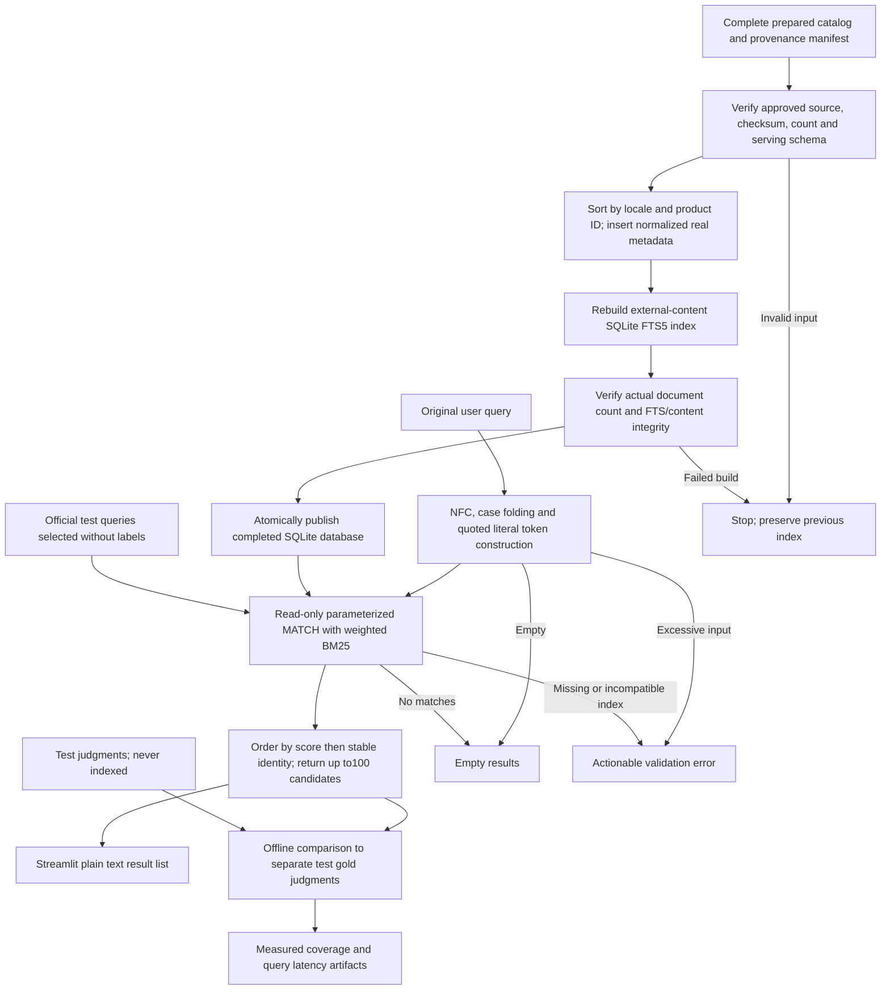

# Iteration 2: lexical product retrieval

The complete prepared catalog is indexed with SQLite FTS5 and ranked with its
built-in BM25 function. The minimal Streamlit page displays actual listing text.
There is no semantic reranking, LLM, predicted ESCI label, recommendation grouping,
or generated explanation.

## Build, run, and evaluate

From the repository root after Iteration 1 preparation:

```bash
uv sync --locked
uv run python scripts/build_index.py
uv run streamlit run app/main.py
uv run python scripts/evaluate_retrieval.py
```

`build_index.py` accepts `--config`, `--data-dir`, `--index-path`, and `--report`.
`evaluate_retrieval.py` accepts `--config`, `--data-dir`, `--index-path`,
`--sample-size` (default 200), and `--output-dir`. Defaults come from
`config/search.toml`: `data_dir=data`, `index_path=data/index/products.sqlite3`,
and the UI candidate count `retrieval_k=100`. The UI shows the first 20 candidates,
with up to 600 description characters, and can display BM25 scores for debugging.
API descriptions are full normalized descriptions, with missing values retained.

Internet is needed only to install dependencies or obtain the original dataset.
Build/search/evaluation use local CPU and files. No API credential is needed.
Allow additional disk space for the index, a temporary full rebuild, and SQLite's
sorting files. The database is about 1 GB for this catalog. Do not run competing
builders against the same destination. If an index is missing or corrupt, the UI
shows a setup/error message instead of creating an empty database.

The existing macOS hidden `.pth` environment issue and the command to clear its
flag are documented in the [README](../README.md). This may need to be applied
immediately before each local Python/Streamlit invocation in this environment.

## Index contract and data flow



The default builder requires the validated prepared manifest for all 482,105
products from revision `e7bb589a050171ed4b97891bd517507f702af0c2`. It verifies the
catalog SHA-256 and actual row count before indexing. The reusable `build_index`
function also supports tiny catalogs with the same schema for focused tests.

`products` stores only locale, product ID, title, brand, color, bullets, and
normalized description. Its composite identity is unique. `product_fts` indexes
those five textual listing fields using external content from `products`.
Neither table contains query IDs/text, judgment IDs, splits, or relevance labels.
The builder never loads judgment Parquet files. Missing descriptions stay SQL
NULL and contribute no description terms.

Products are inserted in sorted identity order. A fresh `.building` database is
created for each build; a failed build leaves the previous published index intact.
The builder checks real FTS document rows in `product_fts_docsize`, not just
external-content `SELECT COUNT(*)`, which alone would not prove indexing. It also
runs FTS/content and SQLite integrity checks. Completion metadata records the
catalog checksum, counts, source-code fingerprint, tokenizer, weights, SQLite
version, and schema version. No timestamp changes the database on each rebuild.

## Retrieval interface and ranking

```python
from smart_product_search.retrieval import retrieve_products

products = retrieve_products("wireless noise cancelling headphones")
products = retrieve_products("13x5.00-6 wheel", k=20, index_path=index_path)
```

The explicit `index_path` is a `pathlib.Path`. Omit it to load the configured path.
The default limit is 100. A zero limit returns no results; a negative or noninteger
limit is invalid. Returned immutable `ProductResult` records expose
`product_locale`, `product_id`, `product_title`, `product_brand`, `product_color`,
`product_bullet_point`, `product_description`, and `bm25_score`.

| Indexed field | BM25 weight |
| ------------- | ----------: |
| Title         |           5 |
| Brand         |           3 |
| Color         |           1 |
| Bullets       |           2 |
| Description   |           1 |

These fixed weights were chosen before test evaluation; they were not tuned.
SQLite's built-in BM25 uses its native scoring conventions: **smaller scores rank
better**, so order is ascending score, locale, product ID. Tied results remain
stable regardless of original Parquet row order. The score is not confidence,
a relevance probability, or an ESCI prediction.

The tokenizer is `unicode61 remove_diacritics 2`. Query preprocessing normalizes
NFC Unicode, case-folds text, extracts alphanumeric tokens, removes duplicate
terms, quotes each token, and joins tokens with OR. User quotes, wildcards,
column filters, boolean syntax, and SQL text are never executed as query syntax.
All MATCH values, ranking weights, and result limits use SQL parameters. Query
length is limited to 1000 characters and 64 distinct terms. Empty, absent, and
token-free input returns an empty list. The original UI input is preserved.

OR matching favors candidate coverage and allows partial lexical matches. There
is no stopword removal, stemming, synonym expansion, attribute filtering, or
understanding of negation. A query's literal `not` or `without` is preserved as a
term but is not a logical exclusion. Punctuation in model numbers is split into
tokens. A candidate may match some words while failing a required brand, size,
quantity, or product type. These limits are reported rather than hidden through
label-based candidate selection or extra model stages.

The serving API opens an existing database read-only and closes each connection.
It does not load Parquet files or check the full catalog checksum per search.
Rebuild explicitly after changing the catalog or indexing settings. The UI uses
`st.text` for listing content; even visible markup from source listings remains
plain untrusted data.

## Evaluation protocol

The evaluation is one fixed BM25 system, not a model comparison or ablation.
Use all 181,701 official test judgments as the source of queries and gold evidence.
Choose 200 query IDs at evenly spaced positions over the 8,956 sorted distinct IDs,
including both endpoints. This selection uses only query IDs/text, not labels or
retrieval outcomes. It is a deterministic systematic sample, not a random sample;
no random seed or population confidence interval is implied. The exact selected
IDs/text are preserved in `selected_queries.json`.

Search the complete 482,105-product catalog once per selected query for top 100
candidates. Only afterward compare candidates to the selected query's known
Exact and Substitute judgments. Report E, S, and their union at K=10 and K=100:

- Per-query judged-positive coverage: known positive products retrieved in top K
  divided by that query's known positive products.
- Macro coverage: mean per-query coverage over queries with at least one positive
  for the specified group. Report eligible-query counts; absent-class queries
  have an undefined denominator and are excluded.
- Micro coverage: total retrieved judged-positive pairs divided by total known
  positive pairs over eligible queries. Report hit and denominator counts.

**ESCI judgments are incomplete across the full catalog. These measurements are
judged-positive recovery on the documented test sample, not guaranteed true
corpus-wide Recall@K.** Unjudged retrieved products are unknown, not irrelevant.
The results do not measure precision or prove arbitrary-query quality. E/S
semantics differ from complements; C and I are not positive for this measurement.

Latency covers the production API call, including query construction, read-only
connection, SQL ranking, full metadata retrieval, and result construction. It
excludes loading gold judgments and computing metrics. Use one sequential call
per selected query, no warmup or result cache. OS filesystem cache state is
uncontrolled, so this is neither a controlled cold-cache nor steady-state SLA.
Report mean, median, p95 (linear interpolation), minimum, and maximum, with raw
per-query timings. Known API errors are recorded and count as no recovered
positives, rather than being silently dropped.

Artifacts are stored in `.artifacts/evaluations/retrieval/`: `selected_queries.json`,
`outcomes.json`, `per_query_coverage.parquet`, and `summary.json`. Summary metadata
includes data/index/code checksums, tokenizer/weights, source revision, versions,
query counts, failed/no-hit counts, and latency protocol. The full verification
report is `.artifacts/iteration-2/acceptance.md`.

## Measured results

These results use the documented 200-query systematic sample and the complete
482,105-product index, with unchanged weights and query policy. They are not
full-test-population or corpus-wide recall estimates.

| Group  |   K | Eligible queries | Judged positives | Recovered | Macro coverage | Micro coverage |
| ------ | --: | ---------------: | ---------------: | --------: | -------------: | -------------: |
| E      |  10 |              200 |             1627 |       437 |       34.7831% |       26.8593% |
| E      | 100 |              200 |             1627 |       886 |       61.8936% |       54.4561% |
| E_or_S |  10 |              200 |             3244 |       632 |       23.5054% |       19.4821% |
| E_or_S | 100 |              200 |             3244 |      1641 |       52.7799% |       50.5857% |
| S      |  10 |              172 |             1617 |       195 |       13.7664% |       12.0594% |
| S      | 100 |              172 |             1617 |       755 |       46.9729% |       46.6914% |

Observed API latency: mean **179.90 ms**, median **114.25 ms**, p95 **457.65 ms**; range 0.50 to 806.78 ms.
Failed calls: 0; queries returning no candidates: 2.
The measured pass followed functional smoke checks and an earlier measurement
before formatting-only changes. No cache was flushed; do not interpret these
timings as cold-start performance or an improvement over the earlier pass.

Concrete observed misses at 100:

- `3m mask n99`: 0 of 13 known E/S products recovered despite 100 returned candidates.
  The fixed lexical ranking does not enforce product type or numeric constraints.
- `apha goc`: 0 of 13 known E/S products recovered; known positive titles include
  `Alpha GPC`. Misspellings are not corrected by literal token matching.
- `bandaids`: 0 of 26 known E/S products recovered; known positive titles include
  `Band-Aid`. Tokenization and lexical variants can leave semantically related
  catalog products outside the retrieved list. No synonym/stemming stage was added.

These are known-judgment recovery failures. Unjudged returned products cannot
be declared irrelevant from this evidence alone.

## Verification and limitations

Offline tests use real SQLite FTS5 on a small fixture corpus. They check complete
insertion, the 100-result default, title weighting, stable ties, missing metadata,
empty/no-hit/excessive queries, literal treatment of FTS/SQL syntax, duplicate and
label rejection, atomic rebuild preservation, and repeated database construction.
Streamlit AppTest executes the actual UI against a real fixture database.
Analytical metric tests distinguish macro/micro coverage and absent-class cases.
Full-catalog validation and live UI/server checks are recorded separately.

Business understanding remains historical product discovery; data understanding
and preparation reuse Iteration 1 evidence. Modeling at this gate is the fixed
lexical BM25 baseline. Evaluation measures coverage and actual latency, and local
deployment is the simple Streamlit UI. Later semantic/model/classification work
and the final product UX remain deferred. No claims about live prices, stock,
images, merchant endorsement, or labeled classes appear in the search results.

Technical reference: [SQLite FTS5 documentation](https://www.sqlite.org/fts5.html).
