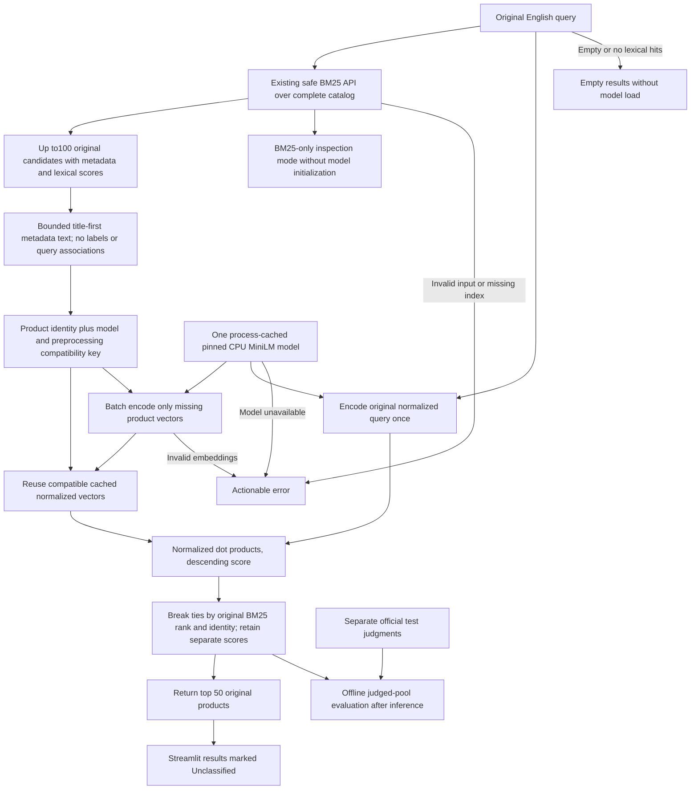

# Iteration 3: local semantic reranking

The current Iteration 3 contract is BM25 top 100, descending MiniLM cosine ranking,
and top 50 output. It supersedes the earlier plan's 50-candidate/RRF/top 10 sketch.
The existing BM25 implementation and complete 482,105-product SQLite index remain
unchanged. There is no score fusion, classifier, LLM integration, predicted ESCI
grouping, or generated explanation.

## Run and reproduce

```bash
uv sync --locked
uv run streamlit run app/main.py
uv run python scripts/evaluate_semantic.py
uv run python scripts/smoke_semantic.py
```

The existing macOS hidden `.pth` flag workaround in [README.md](../README.md)
may be needed immediately before each Python/Streamlit command in this local
environment. A prepared catalog and accepted complete index are prerequisites;
there is no new data preparation or index build in this iteration.

`evaluate_semantic.py` accepts `--config`, `--fixed-queries`, and `--output-dir`.
Its default fixed-query input is the unchanged
`.artifacts/evaluations/retrieval/selected_queries.json` from Iteration 2, with its
accepted index/judgment checksums and saved BM25 rankings alongside it. Output is
`.artifacts/evaluations/semantic/`; no earlier acceptance/evaluation is overwritten.

The first semantic search downloads the pinned model using the standard
`SentenceTransformer` loader. Subsequent loading reuses the Hugging Face cache.
No OpenRouter credentials or remote inference service are needed. BM25-only mode
does not initialize the model or download weights. Initial imports and first model
initialization add startup time; measured model initialization is recorded
separately from steady query inference.

## Central model configuration

All runtime model options are root keys in `config/search.toml`, parsed and
validated by the existing settings loader. Omitted values use these defaults:

| Key                        | Default                                    | Purpose                                          |
| -------------------------- | ------------------------------------------ | ------------------------------------------------ |
| `embedding_model`          | `sentence-transformers/all-MiniLM-L6-v2`   | One fixed pretrained encoder                     |
| `embedding_revision`       | `1110a243fdf4706b3f48f1d95db1a4f5529b4d41` | Exact verified model commit                      |
| `embedding_device`         | `cpu`                                      | Explicit local execution device                  |
| `embedding_batch_size`     | `32`                                       | Encoder batch size                               |
| `embedding_max_seq_length` | `256`                                      | Maximum wordpieces, capped at the model contract |
| `embedding_text_chars`     | `1200`                                     | Total bounded product-text budget                |
| `embedding_cache_size`     | `10000`                                    | Maximum in-memory product vectors                |
| `embedding_threads`        | `4`                                        | PyTorch CPU inference threads                    |
| `retrieval_k`              | `100`                                      | Original lexical candidate count                 |
| `rerank_k`                 | `50`                                       | Semantic output count                            |

The model produces 384-dimensional float32 normalized vectors. Similarity is their
dot product, mathematically cosine for unit vectors; tiny floating-point overshoots
are clipped to [-1,1]. Output shape, finiteness, and unit norms are checked at the
model boundary. PyTorch runs in evaluation/inference mode through Sentence
Transformers; no training, fine-tuning, GPU requirement, or alternate ML backend
was added. Model/configuration values were fixed before evaluating test outcomes.

## Pipeline and interfaces



`retrieve_products(query, k=100, index_path=...)` retains its original BM25-only
contract and code. The unified interface is:

```python
from smart_product_search.search import search_products

semantic_results = search_products("wireless noise cancelling headphones")
lexical_results = search_products("wireless noise cancelling headphones", mode="bm25")
```

An optional `settings=` argument accepts the centralized `SearchSettings` object.
The facade invokes existing retrieval exactly once. Semantic mode returns up to
`rerank_k` results; BM25 mode preserves up to `retrieval_k` results. Empty/no-hit
queries return no results before model initialization; invalid queries retain the
existing input constraints. Fewer than 100 candidates are handled without padding.

`RankedProduct` inherits all original `ProductResult` metadata and `bm25_score`;
it adds one-based `bm25_rank` and optional `semantic_score`. BM25-only results have
`semantic_score=None`. Semantic scores are not relevance probabilities or ESCI
predictions. No lexical/cosine arithmetic mixture is computed.

The product representation takes title, brand, color, bullets, then description,
with individual caps 256/96/64/512/512 characters and a final 1200-character bound.
Use NFC and collapsed whitespace, preserving case, negation, units, punctuation,
and already-cleaned visible text. Do not parse prepared text as HTML a second
time. The model then applies its 256-wordpiece limit. All-missing fields yield an
empty string, not fabricated listing attributes. IDs, BM25 scores, queries, gold
labels, and split/judgment provenance never enter product text.

## Model reuse and product cache

A process-local model factory caches one active model configuration. Relevant
keys are model ID, revision, device, batch/sequence/cache/text limits, and thread
count. Search paths and unrelated future API secrets do not trigger model reloads.
Initialization is serialized; each reranker also serializes encoding/cache updates
so shared Streamlit sessions cannot race on mutable model/cache state.

Product vectors use an in-memory LRU keyed by composite product identity plus a
hash of the exact bounded text, model/revision/device/sequence/text configuration,
and `listing-nfc-bounded-v1` preprocessing version. Content, model, or relevant
preprocessing changes invalidate reuse. A changed field outside the bounded
representation does not alter the actual encoder input. A new model configuration
has its own empty cache. The cache is not persisted and does not survive process
restart. Only products encountered in retrieved pools are encoded, never the full
catalog. Capacity bounds vectors and eviction is deterministic for a fixed search
sequence. No vector database or embedding precomputation job is used.

Each search encodes its query once and batches that query with cache-miss product
texts. Query vectors are not cached. A repeat with unchanged candidates re-encodes
only the query. Counters expose entries/capacity, product hits/misses, encoded
products, and encoded queries. Verification distinguishes cache misses from the
number of candidates considered. These are implementation counters, not quality
scores.

Streamlit defaults to Semantic reranking, offers BM25 only, preserves the existing
form and plain-text cards, displays cosine for semantic results, and keeps BM25
scores behind the existing debug checkbox. The Python process factory persists
across script reruns. Model failure is surfaced honestly; users can explicitly
choose BM25-only mode rather than receiving a silent substituted result.

## Fixed paired evaluation

Use the exact 200 official test queries from Iteration 2. The evaluator checks the
selection against the previous systematic selection and verifies index/judgment
hashes. Each newly retrieved BM25 candidate-ID ordering must equal its saved
Iteration 2 ordering. The model sees only the original query and metadata for those
candidates. Gold labels are consulted only after inference, not for candidate
selection, caching, scoring, or sorting.

Compare E, S, and E-or-S judged-positive coverage at K=10 and K=50, using the same
macro-per-query and micro-per-pair definitions and absent-class handling as
[Iteration 2](RETRIEVAL.md). Missing lexical candidates remain unrecoverable by this
reranker. Unknown catalog relevance is not treated as irrelevant.

For graded ranking, report **conditional judged-pool nDCG@10**. For each query,
fix the judged subset of the original BM25 top 100 pool. Use direct gains
`E=3, S=2, C=1, I=0`, with DCG equal to the sum of `gain/log2(rank+1)`.
For metric computation only, project each complete inferred 100-candidate order
onto that same judged subset, then compute its first 10 judged positions against
the ideal order of that subset. Unknown candidates are skipped, not assigned
zero gain. Known I candidates remain in the judged ranking with zero gain.
Pools with zero ideal gain have undefined nDCG and are excluded with eligible
query counts reported.

The evaluator inspects the full scored 100-candidate ordering to define this
conditional metric; normal production output remains top 50. Projection compresses
unknown positions, so this is **not nDCG at literal display positions, not
catalog-wide nDCG, and not an end-to-end relevance guarantee**. Mean judged counts
in the actual top 10 provide context. Coverage remains a separate measurement on
actual top 10/top 50 results. All queries, including retrieval failures, retain their
coverage denominators. The systematic sample is not a random population estimate.

A fresh evaluation process loads the model once and begins with an empty bounded
product cache. Time BM25 retrieval once and then reranking of those same candidates;
semantic total latency is their sum. Model initialization is reported separately.
There is no explicit warmup, result cache, disk-cache flushing, or GPU timing.
Cache hits/misses and encoded products are retained per query and in aggregate.
Report median and p95 with linear interpolation; ordinary system/cache conditions
are uncontrolled. Do not interpret local timing as a cold-start SLA.

Artifacts under `.artifacts/evaluations/semantic/` preserve fixed queries, complete
IDs/scores and timing/cache outcomes, per-query coverage and nDCG Parquet files,
settings, versions, code/data hashes, and the final summary. The acceptance report
is `.artifacts/iteration-3/acceptance.md`. No other models, parameter search,
ablations, or claims of improvement without measured support are part of this stage.

## Measured component results

Measured on 2026-11-01 using all 200 fixed queries, the unchanged complete index,
and the pinned CPU model. Percentages below are coverage of known positive
judgments, not corpus-wide recall. Macro averages exclude queries lacking the
specified class: 200 eligible E queries, 172 S queries, and 200 E-or-S queries.
Micro denominators are 1,627 E, 1,617 S, and 3,244 E-or-S judged pairs.

| Coverage  | BM25 macro | Semantic macro | BM25 micro | Semantic micro |
| --------- | ---------- | -------------- | ---------- | -------------- |
| E@10      | 34.7831%   | 32.8901%       | 26.8593%   | 23.4788%       |
| E@50      | 55.5183%   | 54.9672%       | 47.8795%   | 47.0191%       |
| S@10      | 13.7664%   | 14.7966%       | 12.0594%   | 13.7910%       |
| S@50      | 37.5822%   | 37.4914%       | 35.8071%   | 37.3531%       |
| E-or-S@10 | 23.5054%   | 22.9356%       | 19.4821%   | 18.6498%       |
| E-or-S@50 | 44.9992%   | 45.3727%       | 41.8619%   | 42.2010%       |

Conditional judged-pool nDCG@10 was **0.884482 BM25 versus 0.899502 semantic**,
with 189 eligible queries and 11 zero-ideal pools excluded for both modes. Mean
judged products in the actual top 10 fell from 3.820 to 3.545. This conditional
increase does not establish better displayed results: projection removes unknown
positions, and Exact coverage actually declined.

| Timed component              | Median      | p95         |
| ---------------------------- | ----------- | ----------- |
| BM25 retrieval               | 169.66 ms   | 558.16 ms   |
| Semantic reranking alone     | 951.59 ms   | 1,329.29 ms |
| BM25 plus semantic reranking | 1,150.29 ms | 1,740.00 ms |

Cached model initialization took 1.103 seconds, excluding Python imports and
the earlier first download. The sequential run considered 19,111 candidate
occurrences, encoded 18,624 product texts and 198 queries, and reused 487 product
vectors. Two queries returned no lexical candidates. The empty initial product
cache ended with 10,000 vectors. These are measured local results, not a general
performance guarantee.

Three additional real-model smoke queries each returned 50 original candidates.
Repeating each search added zero product encodings, produced 100 product cache
hits, and preserved product ordering. The smoke covers only these examples;
floating-point identity across platforms is not established.

### Observed regressions

Inspection used saved model rankings before consulting judgments. No settings
were adjusted after looking at these test outcomes. The three largest E@10 hit
losses were:

- Query 45321, `gildan mens fleece quarter zip`: six known Exact hits became zero.
  The semantic top 10 consisted of full-zip hoodies; nine were unjudged and one S.
  This shows a quarter-zip versus full-zip constraint mismatch in listing text.
- Query 86336, `red dot sight sightmark`: six known Exact hits became one.
  Other brands were promoted, with eight unjudged results and one known S in
  addition to the E result. Brand specificity was weakened.
- Query 96496, `spanx white bodysuit`: seven known Exact hits became two.
  A known I black bodysuit reached rank 2, while the white E listing moved from
  rank 1 to rank 7. Several other promoted products were unjudged. Color
  constraints and the supplied judgments do not always agree: some nonwhite
  listings themselves have E labels, so label coverage alone is insufficient.

Raw IDs, listing titles, and known/unknown labels are retained in
`.artifacts/evaluations/semantic/regression-examples.json`. General-purpose cosine
similarity and bounded listing text are plausible contributors; this validation
does not isolate causal effects. The results support a functioning reranker and
mixed quality changes, not a claim of overall improvement over BM25.

## Verification and known limits

Unit tests replace only the neural encoder with controlled normalized vectors,
using the real cache, ordering, facade, SQLite retrieval, and UI. They require no
model download. Real-model smoke checks separately establish local CPU execution,
vector shape/norms, candidate identity, score stability, and warm-cache reuse.
Existing data/BM25 tests remain in the full suite.

MiniLM is a general sentence encoder, not an ESCI-trained relevance classifier.
Bounded text and wordpiece truncation can omit late specifications. Empty metadata
and incomplete descriptions limit evidence. Cosine can promote related accessories
or miss numeric/brand/negation constraints. The original lexical candidate ceiling
still applies. Any observed regressions and their concrete examples are recorded
without tuning on held-out test judgments.

CRISP-DM: business/data understanding and preparation reuse prior validated
artifacts; modeling adds one fixed pretrained encoder; evaluation is this paired
component protocol; local deployment is the existing Streamlit app. Classification,
final grouping, explanations, and final course deliverables remain later work.

Sources: [MiniLM model card](https://huggingface.co/sentence-transformers/all-MiniLM-L6-v2),
[Sentence Transformers API](https://sbert.net/docs/package_reference/sentence_transformer/model.html).
