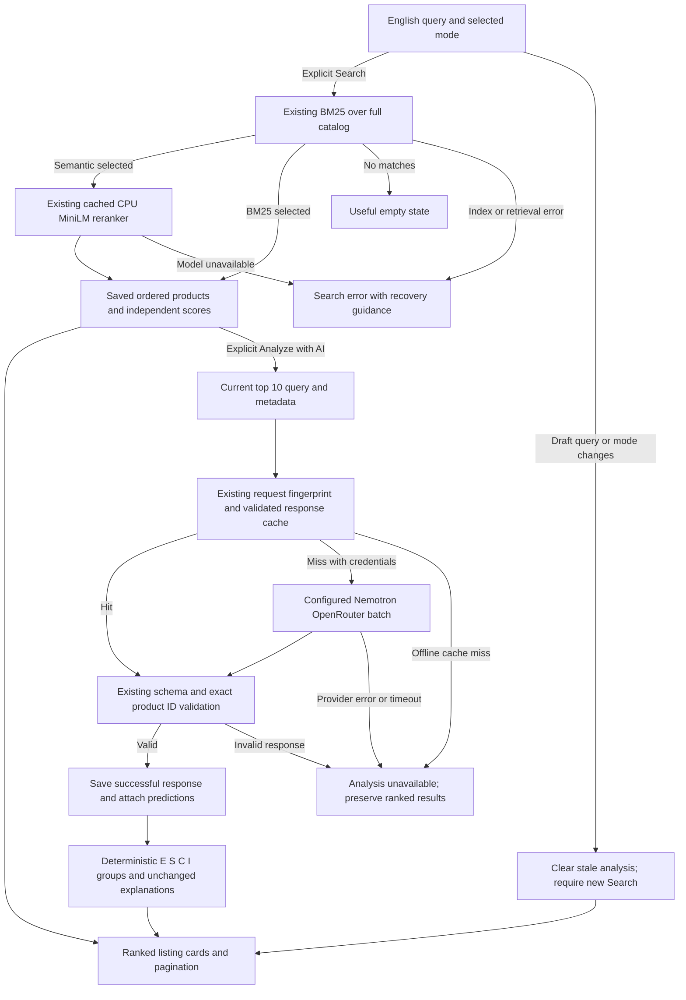

# Iteration 5: product search interface

Smart Product Search is a local research prototype over 482,105 historical Amazon
ESCI English Small listings. It helps users explore an English shopping query,
inspect real listing metadata, and compare model-predicted matches, substitutes,
and complements. It is not an Amazon storefront. There are no purchase links,
invented images, prices, stock indicators, ratings, checkout, or live product feeds.

## Start and configure

From the repository root with the existing prepared catalog and SQLite index:

```bash
uv sync --locked
uv run streamlit run app/main.py
```

Search needs no API key. For AI analysis, copy `.env.example` to ignored `.env`
and set `OPENROUTER_API_KEY`. The default `llm_model` in `config/search.toml` is
`nvidia/nemotron-3.5-super-vl:free`; optional `OPENROUTER_MODEL` overrides it through
the existing `decouple` loader. There is no automatic model substitution. Do not
put credentials in TOML or documentation. Restart the app after changing runtime
configuration. See [classification configuration](CLASSIFICATION.md#run-and-configure)
for timeout, tokens, temperature, retries, and persistent cache settings.

If the index is absent, prepare the data and explicitly run
`uv run python scripts/build_index.py` as described in [README](../README.md).
The UI never builds an index. On affected macOS environments, apply the README's
editable `.pth` hidden-flag repair before a Python or Streamlit command.

## User workflow

1. Enter an English request such as `waterproof hiking backpack 35 liter`.
2. Leave **BM25** selected or choose **Semantic**, then select **Search**.
3. Inspect ranked cards with titles, available descriptions, brands, and colors.
   **Product details** exposes the product ID and available descriptive text.
   Initially 20 cards are shown; **Show more products** reveals another 20 from
   saved results without searching again. Missing descriptions are indicated.
4. Optionally select **Analyze with AI** to classify the current top 10, or all
   results if fewer than 10 exist. One batch request uses the existing prompt,
   schema validation, and cache. The original query and listing metadata are the
   inference inputs. Official relevance judgments are never loaded by the UI.
5. Inspect counted groups and short **AI explanation** text. The subtle source
   caption says `api` or `cache`. These are predictions, not verified matches.

| Section                       | Meaning                                                       | Presentation                                    |
| ----------------------------- | ------------------------------------------------------------- | ----------------------------------------------- |
| Exact Matches (E)             | Predicted to directly satisfy the request                     | Visible, including an empty-state message       |
| Alternatives (S)              | Predicted to replace the requested item for a similar purpose | Visible, including an empty-state message       |
| Accessories & Complements (C) | Predicted to be used with the requested item                  | Visible, including an empty-state message       |
| Other Results (I)             | Predicted to be less relevant                                 | Counted, collapsed, expandable                  |
| More products, not analyzed   | Outside the analyzed batch                                    | Separate expandable ranked list with pagination |

Every E/S/C/I section shows its actual count, including zero. Products retain
their original retrieval order within each group and their original result number.
Grouping is deterministic code over validated labels; it makes no extra model
calls and creates no products, confidence scores, or explanations. Unanalyzed
products never become Irrelevant by default. Listing and explanation text is
escaped before Markdown rendering, including links, HTML, and math delimiters.
Long text is shortened for readability: a 400-character preview and up to 3,000
characters per description or bullet field in details, with a truncation notice.

**Search details** is collapsed by default. It contains stage timings, model/status
when analysis was attempted, and **Show retrieval scores**. BM25 scores and cosine
similarity remain separate; neither is a relevance probability.

## Modes, state, and failure behavior

BM25 returns up to 100 lexical matches from the full catalog. Semantic retrieves
the same BM25 top 100, reranks with local CPU MiniLM, and returns up to 50. It does
not expand the lexical candidate pool. BM25 is the default because the prior
evaluation found mixed semantic changes, including weaker Exact coverage. The
first Semantic request may require model loading or a standard Hugging Face
download. The existing process-cached model and bounded product-vector cache
survive Streamlit reruns. See [the measured component results](SEMANTIC_RERANKING.md).

Search and analysis are explicit buttons. Ordinary reruns, product expanders,
score inspection, and pagination do not retrieve, encode, or classify again.
Session state retains the actual submitted query, mode, results, and analysis.
When an edited query or mode reaches Streamlit, analysis is cleared, the previous
result context remains visible, and **Analyze with AI** is disabled until **Search**
applies the changes. A new search resets pagination and clears prior analysis.

Searching shows a loading indicator. Empty input prompts for a query; no matches
suggest broader wording. Index, model, and retrieval errors are shown explicitly.
Analysis has a separate loading state. Missing credentials, provider failures,
timeouts, rate limits, and invalid structured responses produce an unavailable
warning while retaining ranked products, without E/S/C/I groups. Reruns do not
retry analysis. Another explicit analysis action may retry according to the existing
bounded backend retry policy. Successful persistent cache entries remain usable
without credentials or provider access. Cache identity and validation are unchanged;
see [the cache contract](CLASSIFICATION.md).



## Verified behavior and limits

Iteration 5 adds presentation and state handling, not a new NLP model or quality
experiment. Offline AppTests cover explicit actions, both modes, grouping/order,
empty categories, missing metadata, stale drafts, cache replay, failures, literal
text, and reruns. A full-index AppTest used actual BM25 and CPU MiniLM with an
isolated mocked classification transport. It returned 100/50 products, validated
10 predictions per mode, replayed cache without credentials, and retained results
on a synthetic 429. Repeating Semantic search encoded zero additional products
and reused 100 product embeddings. Native Chrome inspection confirmed product
cards, counted groups, expandable Other Results, and API/cache source changes.
No new live OpenRouter inference was performed for this UI iteration.

Detailed commands, actual test counts, interaction timings, and visual inspection
scope are recorded in `.artifacts/iteration-5/acceptance.md`. The full-index smoke
is a small functional check with synthetic categories, not evidence of improved
classification quality or a latency benchmark. It does not measure provider latency.

The previous held-out classification evaluation measured 53.27% accuracy and
0.4653 macro-F1 on 199 judged pairs. Complement has only five examples, making its
per-class estimate unstable. Explanations are not independently fact-checked, and
incomplete historical metadata can omit critical specifications. Labels are
incomplete over the full catalog, so prior classification metrics do not establish
end-to-end relevance. Free provider availability and hosted model behavior can
change. Separate processes may duplicate simultaneous uncached requests; session
results do not survive a browser session reset. No accessibility certification or
exhaustive device/browser compatibility testing was performed.
